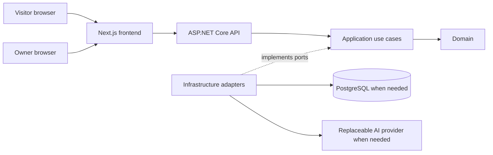

# Architecture

Status: proposed target; no application runtime is implemented yet. The
constitution is authoritative. See [the foundation plan](../specs/002-engineering-foundation/plan.md)
for the implementation sequence and decision rationale.

## System context

The frontend and backend are independently buildable. The browser never
receives provider credentials or a database connection. The public experience
must remain usable when the chat provider is unavailable.

## Frontend

Proposed: Next.js App Router, React, strict TypeScript and Tailwind CSS.
Use static/prerendered public routes where feasible; introduce a Node runtime
only when an approved requirement needs request-time rendering. Keep chat,
timeline and administration interactive features isolated. Choose the final
rendering/deployment approach before scaffolding, including how approved content
updates become visible. Do not implement authentication or database access in
Next.js as a second business backend.

Feature folders own their components, hooks, API calls and schemas. Shared UI
primitives use common tokens. Localization resources start with Spanish and
English infrastructure; do not publish unreviewed translations. Server data,
URL state and transient UI state have distinct owners.

## Backend

Target project names:

- Portfolio.Domain: domain types, invariants and rules; framework independent.
- Portfolio.Application: use cases and interfaces for persistence and external services.
- Portfolio.Infrastructure: concrete adapters, EF Core/PostgreSQL when required.
- Portfolio.Api: endpoints, validation, middleware, authorization and composition.

Allowed dependencies:
- Application -> Domain.
- Infrastructure -> Application and Domain.
- Api -> Application; Infrastructure only for registration and composition.
- Domain -> no other application project.

A single modular backend host is sufficient. Implement modules only as their
feature specifications require. Publish real contracts using OpenAPI. No
database, provider integration or admin endpoints are required for the
initial health endpoint.

## Product capabilities (future)

- Portfolio content: verified profile and project case studies.
- Timeline: ordered milestones, grouped events and presentation-only animation.
- Conversational engine: authoritative session state, scope and outcome policy,
  approved knowledge, structured public events and replaceable AI adapter.
- Administration: protected content publication and knowledge management.

These are feature boundaries, not claims of existing code. The engine does
not obtain unrestricted access to other repositories or databases.

## Security and deployment

The public repository contains safe examples only. Runtime secrets are
server-side. Separate public and admin operations; protected resources require
server-side authorization. Define visitor-data retention before persistence.

Render is the proposed deployment platform. Initial deployment should use the
fewest services consistent with rendering and runtime requirements. CI must
validate the actual builds and tests before application changes are merged.
